  

  

<h2 align="center">Hello World, I'm Luiz, be very welcome</h2>

  

### About me

Full Stack Developer and student of the **Systems Analysis and Development** technical program at **SENAI**. I build complete products, from the database and the API to the web dashboard and the mobile app.

- **Front-end:** responsive interfaces with React, TypeScript, JavaScript, HTML and CSS
- **Back-end:** PHP, Node.js/Express, REST APIs and SQL databases (MySQL, PostgreSQL, Supabase)
- **Mobile:** cross-platform apps with Flutter
- **IoT:** ESP32 sensor monitoring integrated into apps and dashboards
- **Project management:** agile teams (Scrum) using AI tools to plan, build and deliver faster

### Tech stack

  
    
  
    
  

### GitHub stats

  
  

  

### Featured projects

| Project | Description | Stack |
|---|---|---|
| [**SafeCore**](https://github.com/Mxthxzy000/SafeCore) | Industrial safety monitoring: IoT sensors (gas, temperature, pressure) feeding a real-time mobile app and a web admin dashboard. SENAI final project. | Flutter, React, TypeScript, Supabase, ESP32 |
| [**SOUL Dashboard**](https://github.com/Mxthxzy000/projeto-soul-dashboard) | Business management platform: website with subscription plans and an admin dashboard for scheduling, inventory, finance and reports. | React, TypeScript, Tailwind, Supabase |
| [**TechForge**](https://github.com/Mxthxzy000/techforge-ecommerce) | Tech e-commerce with catalog, cart, checkout, PC builder, chatbot and admin panel. | PHP, MySQL, JavaScript |
| [**MusicStream**](https://github.com/Mxthxzy000/MusicStreamApp) | Retro music streaming platform with a web app and a mobile app. | React, Flutter, Supabase |
| [**Pokedex Mobile**](https://github.com/Mxthxzy000/pokedex-mobile) | Pokedex app with Supabase back-end and photo upload. | Flutter, Supabase, SQL |
| [**HelpDesk Industrial**](https://github.com/Mxthxzy000/prepara-o-devexperience-2026) | Ticketing system built for the DevExperience 2026 competition. | PHP, MySQL, CSS |

  

